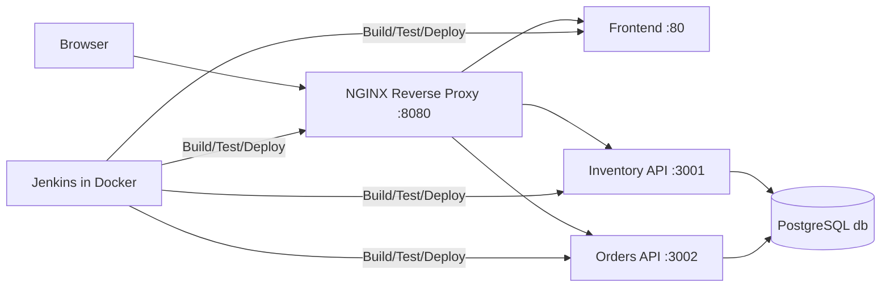

# Store Inventory System

A containerized inventory and orders system built for a classroom final project. The project demonstrates a multi-service Docker stack, PostgreSQL persistence, Jenkins automation, CI/CD deployment, health checks, rollback planning, and automated testing.

## Project purpose

This project was designed to meet the requirements of a final project in systems integration, DevOps, and application deployment. The goal is to show a working multi-module application running as separate Docker services, with a reverse proxy, persistent database, and root-level Jenkins pipeline.

## Implemented features

- Responsive frontend for inventory and order management
- Inventory API with CRUD and validation
- Orders API with order creation and stock validation
- PostgreSQL database with relational schema and seed data
- Docker Compose orchestration for all services
- NGINX reverse proxy for a single entry point
- Jenkins pipeline with checkout, test, build, deploy, health, and smoke test stages
- Versioned image tags using Jenkins build numbers
- Automated tests that block deployment on failure
- Health endpoints and smoke checks
- Database persistence using a named Docker volume
- Documentation for local setup, rollback, and troubleshooting

## Architecture summary

The system is composed of:

- Frontend: React app served through NGINX
- Inventory API: Express REST API on port 3001
- Orders API: Express REST API on port 3002
- Database: PostgreSQL 16 in a named volume
- Reverse proxy: NGINX entry point on port 8080
- Jenkins: separate Dockerized Jenkins environment in `infra/jenkins/`

## Architecture diagram



## Technology stack

- Frontend: React + Vite + Nginx
- Inventory API: Node.js + Express
- Orders API: Node.js + Express
- Database: PostgreSQL 16
- Proxy: NGINX
- CI/CD: Jenkins in Docker
- Container orchestration: Docker Compose

## Repository structure

```text
store-inventory-system/
├── .env.example
├── .gitignore
├── docker-compose.yml
├── Jenkinsfile
├── README.md
├── db/
│   └── init.sql
├── docs/
│   ├── architecture.md
│   ├── api-reference.md
│   ├── ci-cd.md
│   ├── testing-strategy.md
│   ├── deployment-rollback.md
│   ├── requirements-traceability.md
│   └── DELIVERABLES-CHECKLIST.md
├── frontend/
│   ├── Dockerfile
│   ├── .dockerignore
│   ├── package.json
│   ├── vite.config.js
│   ├── index.html
│   └── src/
├── infra/
│   └── jenkins/
│       ├── Dockerfile
│       └── docker-compose.yml
├── inventory-api/
│   ├── Dockerfile
│   ├── .dockerignore
│   ├── package.json
│   ├── server.js
│   └── tests/
├── orders-api/
│   ├── Dockerfile
│   ├── .dockerignore
│   ├── package.json
│   ├── server.js
│   └── tests/
├── proxy/
│   ├── Dockerfile
│   └── nginx.conf
└── tests/
```

## Prerequisites

Install the following tools:

- Git
- Docker Desktop (Windows/macOS) or Docker Engine (Linux)
- Docker Compose v2
- Node.js 20+ if running services locally without Docker
- A browser to access the frontend

## Windows PowerShell setup

Run these commands in PowerShell from the project root:

```powershell
Copy-Item .env.example .env

# Build containers
# If needed, first ensure Docker Desktop is running

docker compose up -d --build

# Check running containers
docker compose ps

# View logs
docker compose logs -f

# Stop services
docker compose down
```

If you want to remove persistent database data, use:

```powershell
docker volume rm store-inventory-system_pgdata
```

Use this with caution because it deletes persisted inventory data.

## Configuration

The `.env` file is not committed. It includes values such as database credentials and the version tag. Example:

```dotenv
POSTGRES_DB=store_inventory
POSTGRES_USER=postgres
POSTGRES_PASSWORD=change_me
TAG=latest
```

## Local startup and shutdown

### Start the application

```bash
docker compose up -d --build
```

### Stop the application

```bash
docker compose down
```

### Restart after making changes

```bash
docker compose up -d --build --force-recreate
```

### Service URLs

- Frontend: http://localhost:8080
- Inventory API: http://localhost:8080/api/inventory
- Orders API: http://localhost:8080/api/orders
- Health endpoints:
  - http://localhost:8080/health
  - http://localhost:8080/api/inventory/health (proxied route)
  - http://localhost:8080/api/orders/health (proxied route)

## API examples

### Create an inventory item

```bash
curl -X POST http://localhost:8080/api/inventory \
  -H "Content-Type: application/json" \
  -d '{
    "name": "Wireless Mouse",
    "sku": "WM-001",
    "description": "Ergonomic mouse",
    "quantity": 12,
    "price": 24.99,
    "low_stock_threshold": 5
  }'
```

### Create an order

```bash
curl -X POST http://localhost:8080/api/orders \
  -H "Content-Type: application/json" \
  -d '{
    "customerName": "Sample Customer",
    "items": [
      { "sku": "WM-001", "quantity": 2 }
    ]
  }'
```

## Database persistence

The PostgreSQL database uses a named Docker volume called `pgdata`. This means the storage survives container restarts and normal `docker compose down` operations as long as the volume is not explicitly removed.

Important:

- `docker compose down` stops and removes containers but keeps named volumes.
- `docker compose down -v` removes volumes and deletes data.
- Use caution before deleting persistent data.

## Local testing

From the project root:

```bash
npm install --prefix inventory-api
npm install --prefix orders-api
npm install --prefix frontend

npm test --prefix inventory-api -- --runInBand
npm test --prefix orders-api -- --runInBand
```

The test suite validates:

- Health endpoints
- Inventory CRUD and validation
- Duplicate SKU prevention
- Invalid quantity and pricing rules
- Orders creation and rejection logic
- Stock preservation on failed orders

## Jenkins setup

The Jenkins instance is kept in a separate folder under `infra/jenkins/` and uses Docker Compose. The setup is designed for local lab use and educational demonstration.

### Start Jenkins

```bash
cd infra/jenkins
docker compose up -d --build
```

Open the Jenkins UI at:

- http://localhost:8081

### First-run steps

1. Retrieve the admin password:

```bash
docker exec jenkins cat /var/jenkins_home/secrets/initialAdminPassword
```

2. Install the suggested plugins.
3. Create your first admin user.
4. Install the Docker Pipeline plugin.
5. Add a credentials entry named `store-inventory-env` with a real `.env` file.
6. Create a Pipeline job pointing to this repository and set Script Path to `Jenkinsfile`.

## GitHub to Jenkins automatic trigger

You can use either of the following trigger methods:

- GitHub webhook (preferred)
- Jenkins Poll SCM fallback

For a webhook, configure an endpoint that points to your Jenkins server and enable the GitHub hook trigger.

Example:

- Jenkins URL: http://your-host:8081
- GitHub Webhook: push events
- Jenkins job: GitHub hook trigger for GITScm polling

If your environment is private or offline, Poll SCM is acceptable and still counts as automated triggering.

## Jenkins pipeline stages

The root Jenkinsfile includes these stages:

1. Checkout source code
2. Validate configuration
3. Install dependencies
4. Run automated tests
5. Build Docker images
6. Deploy selected version
7. Wait for healthy services
8. Run HTTP smoke tests
9. Publish deployment information

If tests fail, the pipeline stops before deployment.

## Versioning and rollback

Images are tagged with the Jenkins build number, so each deployment gets a unique version value.

To identify the currently running version, inspect the page or container labels.

Sample rollback command:

```bash
docker compose up -d --no-build
```

The tag used in deployment is controlled by the `TAG` environment variable in the Compose file and Jenkins environment. Keep the version consistent across builds, deployment, and rollback.

Rollback is documented as a manual recovery procedure. It is suitable for this classroom environment, and it should be verified before any production use.

## Troubleshooting

### Docker not running

Check that Docker Desktop is running or that the Docker engine is active.

```bash
docker version
docker compose version
```

### Container health issues

```bash
docker compose ps
docker compose logs --tail=200 inventory-api orders-api proxy
docker compose restart inventory-api orders-api proxy
```

### Frontend not loading through proxy

Check that the proxy is routing correctly and the frontend container is running.

```bash
docker compose logs --tail=200 proxy frontend
```

### Database connection errors

Verify that PostgreSQL is healthy and the environment variables match the running value.

```bash
docker compose logs --tail=200 db
```

### Tests fail in Jenkins

The pipeline stops before deployment. Review the test output and fix the failing code before retrying.

## Security notes

- Never commit real `.env` files or secrets to Git.
- Keep the Jenkins host in a protected local lab environment.
- The Docker socket mount used in the Jenkins lab setup is for demonstration and should not be treated as a hardened production configuration.

## Verified vs unverified

Verified by implementation and configuration:

- Multi-container Docker architecture
- Inventory and order functionality
- Automated API tests using Node.js + Jest
- Docker Compose configuration
- Jenkinsfile structure
- Documentation and setup flow

Unverified until run in a real environment:

- Jenkins automatic trigger against GitHub
- Full pipeline execution in Docker
- End-to-end smoke tests against live deployment
- Live rollback demonstration

## Team roles and contribution placeholders

- Project Lead / DevOps Engineer: Rama, Ezekiel P.
- Backend Engineer: Ong, Jhieffer Drake S.
- Infrastructure Engineer: Carbungco, Sherwin L.
- Frontend / QA Lead: Malong, Gian Jose B.
- Documentation / Presentation Lead: Paras, Rafael John S.

## Final notes

This repository is a strong academic project baseline for a Docker-and-Jenkins demonstration. It is intentionally scoped to a reliable, maintainable system that can be explained clearly in class and demonstrated live.
