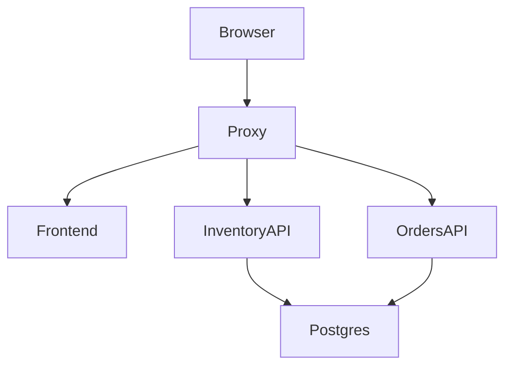

# Software architecture

## Overview

This project is a small but complete store inventory environment with a frontend, two backend APIs, and a shared PostgreSQL database. The architecture separates responsibilities so each service can be independently built, tested, and deployed.

## Layered design

- Presentation layer: React frontend served by nginx
- Application layer: Inventory API and Orders API
- Data layer: PostgreSQL with seed data and relational tables
- Platform layer: Docker Compose and reverse proxy
- Automation layer: Jenkins pipeline over Docker

## Service responsibilities

- Frontend: display records and allow inventory and order creation
- Inventory API: CRUD for inventory items and validation rules
- Orders API: create orders, calculate totals, and enforce stock checks
- PostgreSQL: persistent state for inventory and order data
- Proxy: route browser requests by path to the correct service

## Network model

The application uses a single Docker bridge network named `store-net`.

- Proxy exposes port 8080 to the host
- Frontend, Inventory API, Orders API, and DB communicate internally over the Docker network
- DB remains isolated; it does not expose a host port

## Request flow

1. Browser sends a request to `http://localhost:8080`
2. NGINX inspects the path and forwards traffic to the correct backend service
3. The frontend loads data from the inventory and orders APIs
4. Orders API checks stock and updates PostgreSQL
5. Inventory API stores and retrieves inventory records

## Diagram

